<!-- ═══════════════════════════════ HEADER ═══════════════════════════════ -->
<div align="center">


<h3>Hi there!  Welcome to my corner of GitHub</h3>

<a href="https://git.io/typing-svg"></a>

<p>
  <a href="https://x.com/turtlePowerYo"></a>
  <a href="mailto:evobio721@gmail.com"></a>
  <a href="https://github.com/btmartin721?tab=followers"></a>
  
  <!-- Want more? Copy a badge above and swap in Google Scholar, ORCID, LinkedIn or Bluesky, e.g.
  <a href="https://orcid.org/YOUR-ORCID"></a>
  <a href="https://scholar.google.com/citations?user=YOUR-ID"></a>
  -->
</p>


</div>

## 🧬 About Me

I am a computational biologist and genomic data scientist focusing on evolutionary biology and population genomics. My research specifically targets genomic SNP datasets from non-model organisms. My work bridges the gap between biological research and software engineering. I develop AI software to analyze both short-read and long-read genomic data.

```python
class BradleyMartin(ComputationalBiologist, SoftwareEngineer):
    """Genomic data scientist · evolutionary biologist · package author."""

    degree  = "PhD"
    studies = ["evolutionary biology", "population genomics"]
    data    = ["SNPs", "short reads", "long reads", "non-model organisms"]
    builds  = ["SNPio", "PG-SUI"]
    toolkit = ["Python", "PyTorch", "R", "C++", "Slurm/HPC", "Docker", "AWS"]

    def philosophy(self) -> str:
        return "Missing data is just data we haven't predicted yet."
```

## 🚀 Active Projects

<table>
  <tr>
    <td width="50%" valign="top">
      <h3>🧬 <a href="https://github.com/btmartin721/SNPio">SNPio</a></h3>
      <p>An all-in-one file I/O and population genomic analytical API designed for robust data manipulation.</p>
      <p>
        <a href="https://pypi.org/project/snpio/"></a>
        
        <a href="https://github.com/btmartin721/SNPio/stargazers"></a>
        
      </p>
    </td>
    <td width="50%" valign="top">
      <h3>🧠 <a href="https://github.com/btmartin721/PG-SUI">PG-SUI</a></h3>
      <p>A computational tool utilizing deep learning to impute missing data in population genomic SNP datasets.</p>
      <p>
        <a href="https://pypi.org/project/pg-sui/"></a>
        
        <a href="https://github.com/btmartin721/PG-SUI/stargazers"></a>
        
      </p>
    </td>
  </tr>
</table>

<div align="center">
  
  <br>
  <sub><i>The idea behind PG-SUI in one loop: sweep the genotype matrix, fill every missing call (<code>./.</code>) with a prediction.</i></sub>
</div>

## 🔭 Current Directions

- 🤖 AI methods for population genomic SNP imputation
- 🐍 Scientific Python tooling for genomics workflows
- ⚡ HPC-enabled analysis pipelines
- 🧵 Long-read and short-read genomic data integration
- ♻️ Reproducible computational biology

## 🧰 Technical Toolbox

**Languages & Scripting**<br>


**Machine Learning, HPC & Infrastructure**<br>


## 📊 GitHub Stats

<div align="center">
  <picture>
    <source media="(prefers-color-scheme: dark)" srcset="https://github-readme-stats.vercel.app/api?username=btmartin721&show_icons=true&include_all_commits=true&count_private=true&rank_icon=github&border_radius=10&bg_color=0d1117&title_color=36BCF7&icon_color=a371f7&text_color=c9d1d9&ring_color=36BCF7&border_color=30363d">
    
  </picture>
  <picture>
    <source media="(prefers-color-scheme: dark)" srcset="https://github-readme-stats.vercel.app/api/top-langs/?username=btmartin721&layout=compact&langs_count=8&hide=html,css&border_radius=10&bg_color=0d1117&title_color=36BCF7&text_color=c9d1d9&border_color=30363d">
    
  </picture>
  <br>
  <picture>
    <source media="(prefers-color-scheme: dark)" srcset="https://streak-stats.demolab.com?user=btmartin721&border_radius=10&background=0D1117&border=30363D&stroke=30363D&ring=36BCF7&fire=A371F7&currStreakNum=C9D1D9&sideNums=C9D1D9&currStreakLabel=36BCF7&sideLabels=36BCF7&dates=8B949E">
    
  </picture>
</div>

<div align="center">
  <h3>🐍 My GitHub Contributions</h3>
  <picture>
    <source media="(prefers-color-scheme: dark)" srcset="https://raw.githubusercontent.com/btmartin721/btmartin721/output/github-contribution-grid-snake-dark.svg">
    <source media="(prefers-color-scheme: light)" srcset="https://raw.githubusercontent.com/btmartin721/btmartin721/output/github-contribution-grid-snake.svg">
    
  </picture>
</div>

<!-- ═══════════════════════════════ FOOTER ═══════════════════════════════ -->
<div align="center">

<br>

<picture>
  <source media="(prefers-color-scheme: dark)" srcset="https://quotes-github-readme.vercel.app/api?type=horizontal&theme=dark">
  
</picture>


<sub>🐢 turtle power, yo.</sub>


</div>
